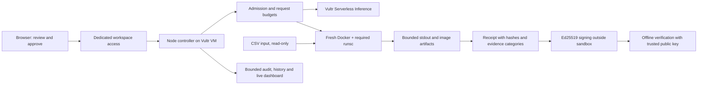

# SafeCode Agent

**Customer CSV → reviewed code → restricted execution → signed evidence.**

SafeCode is a competition prototype for Vultr Agent Rush, Challenge 1. Vultr Serverless Inference generates code; the operator reviews it; a fresh restricted sandbox executes each attempt; the application returns output, charts and an execution receipt. The commercial direction is a dedicated private pilot for AI teams adding customer-file analysis.

## Start here

- [Every feature: behaviour, limitations and demonstration](docs/FEATURES.md)
- [Competition walkthrough and evidence commands](docs/DEMO.md), also available in the app at `/demo.html`
- [Deployment and operations](docs/OPERATIONS.md)
- [Threat model and receipt trust boundaries](docs/SECURITY.md)
- [API and Python integration](docs/API.md)
- [Current validation record](docs/VALIDATION.md)
- [Remaining competition plan](docs/REMAINING-PLAN.md)
- [Submission kit](HACKATHON.md)
- [Engineering backlog](docs/BACKLOG.md)

## What v0.3 adds

Authenticated dedicated-workspace access; bounded concurrency and persistent daily attempt/model-request budgets; cancellation and an operator pause switch; required-runtime enforcement; digest-pinned images in production; a bounded production scratch filesystem; safer artifact collection; optional Ed25519 receipt signatures (required in production); separate IDs for every execution; explicit evidence categories; data-retention/deletion controls; model-data-sharing switches; feature demos and security regressions.

This is a **single trusted operator/team workspace**, not a multitenant service. Everyone given its access token can view its data and operate its controls. Use separate deployments for different customers. No independent adversarial assessment or sandbox-escape certification has been completed.

## Local development

Node 20+; no npm dependencies. Linux Docker or bubblewrap is needed to execute programs. Without a sandbox the UI and portable tests work, but execution fails closed.

```bash
cp .env.example .env
npm run lint
npm test
npm run build
npm start
```

Open `http://127.0.0.1:4321`. With no key, the model is explicitly labelled as an offline mock. An unauthenticated development instance binds only to loopback. Do not expose it through a proxy. Docker images must be pulled in advance (`python:3.12-alpine`, `bash:5` for development).

On a prepared, disposable Linux test machine:

```bash
npm run test:integration
```

Portable tests do not establish Linux sandbox containment. Integration tests intentionally fail when no runtime is available. Existing screenshots in `docs/01-…13-…png` are **historical v0.2 captures**, not evidence for v0.3.

## Architecture



Production requires runsc, digest-pinned images, authenticated access, a receipt key and a dedicated tmpfs of at most 64 MiB. The setup script configures these prerequisites. The controller has Docker privileges and is part of the trusted computing base; compromising it can invalidate the execution story.

## Evidence, precisely

The controller observes its timeout and process lifecycle. Most other containment categories are **inferred from untrusted program output**, and are labelled accordingly. A program printing `MemoryError` does not prove the memory limit fired. The static policy scan is advisory, not an enforcement boundary.

Receipts include code/input/output hashes, policy digest, runtime image identity, configured limits, lifecycle, per-attempt code/model attribution and explicit limitations. The signature authenticates the issuer’s record and detects changes relative to a separately trusted public key. It does not prove no escape occurred, that observations are complete, or that program-reported numbers are correct. HTML is a readable rendering; verify the JSON.

CSV previews and execution output are not shared with the model by default. Prompts, code-generation requests and filenames still reach the selected inference provider. Enable input/output sharing only for approved data; live self-healing and model explanations require output sharing. See [data flows](docs/SECURITY.md).

## Vultr and competition

Vultr Cloud Compute hosts the controller, Caddy and executor. Vultr Serverless Inference handles live generation, optional repair and explanation. OpenAI is a local-development fallback; offline mock output is not a live Vultr demonstration. The [official event page](https://lablab.build/ai-hackathons/vultr-hackathon) was checked on 2026-11-06. Live deployment, recording and submission remain separate steps; see the [submission checklist](HACKATHON.md).

MIT licensed.
