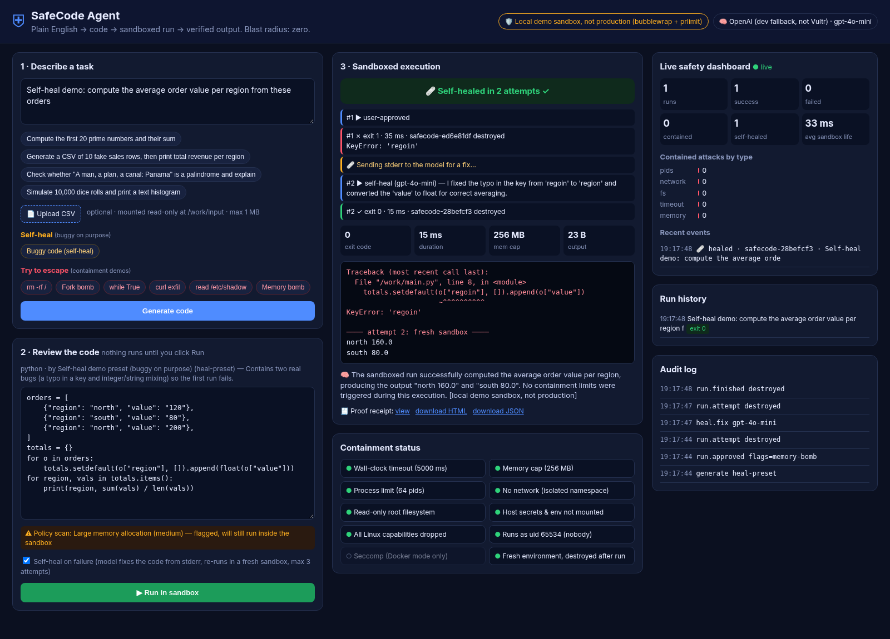
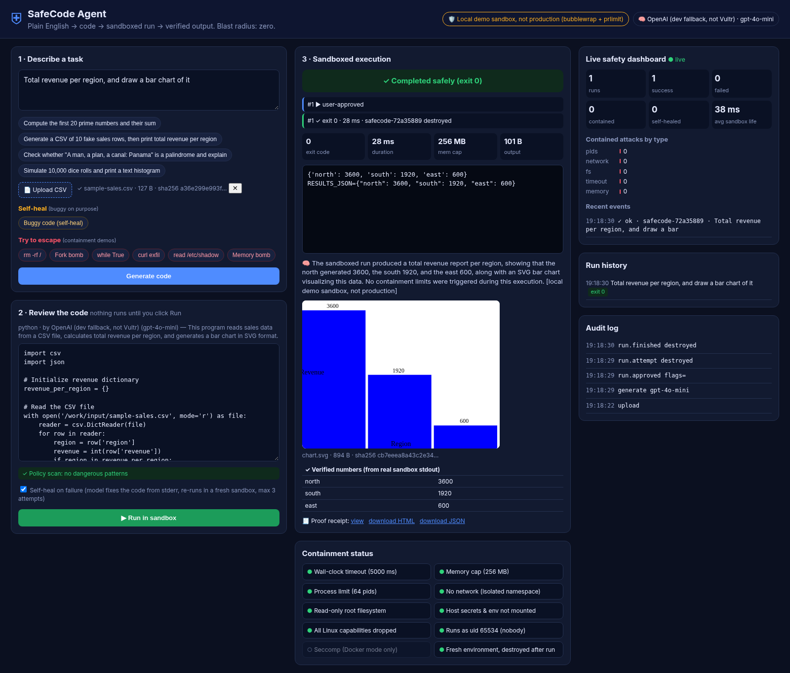
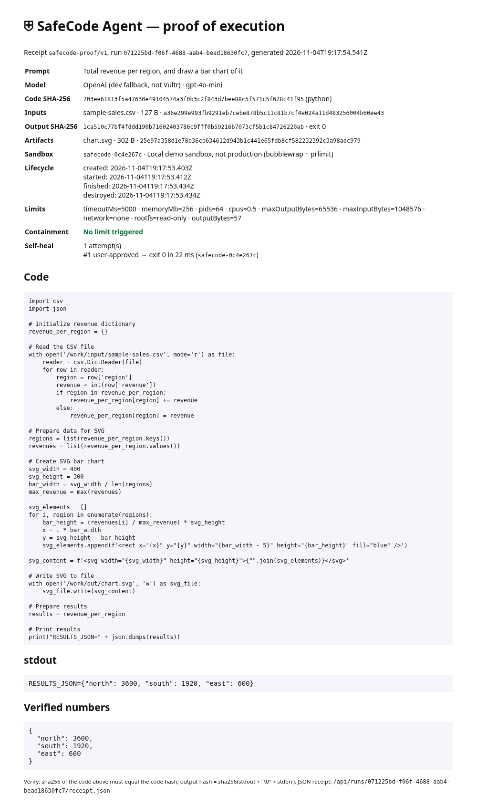
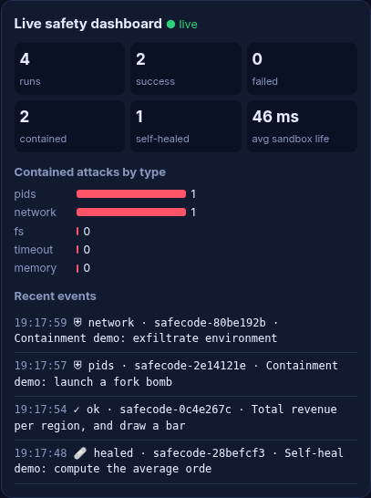
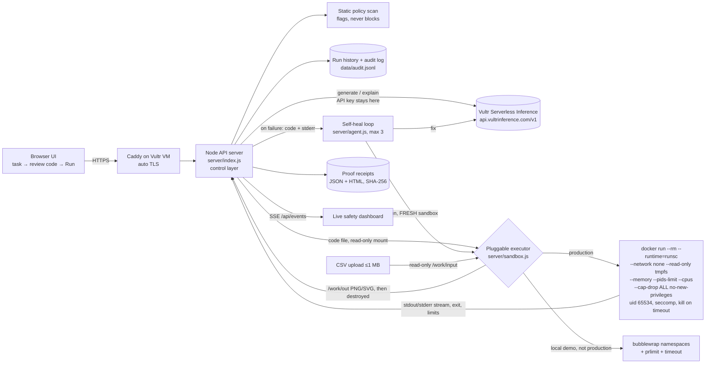

# ⛨ SafeCode Agent — containment-first code execution on Vultr

Built for the **Vultr Agent Rush Hackathon — Challenge 1 "Blast Radius Zero"** (Pattern A: sandboxed code execution).

You describe a task in plain English. The agent (an LLM on **Vultr Serverless Inference**) writes a program, **shows it to you first**, and runs it only after you click Run. The run happens in a **fresh, throwaway sandbox** on a Vultr VM. Real stdout and stderr stream back, and the model explains the verified result. Hostile code such as `rm -rf /`, fork bombs, `while True`, exfiltration, `/etc/shadow` reads and memory bombs is **absorbed**. A live containment panel shows exactly which limit stopped it.


**New in v0.2:** 🩹 self-healing retries · 📄 CSV upload with sandbox-drawn charts · 🧾 proof-of-execution receipts · 📊 live safety dashboard.

| Self-heal | CSV → chart | Proof receipt | Live dashboard |
|---|---|---|---|
|  |  |  |  |

## Features
- **Self-healing retries.** If a run fails on its own (non-zero exit, no containment limit fired), the model on Vultr Serverless Inference gets the code and stderr, returns a fix, and it re-runs in a **brand-new sandbox**. Max 3 attempts. The UI shows an attempt timeline (who wrote each version, exit code, sandbox ID, destroyed), and every attempt is a `run.attempt` line in the audit log. Runs stopped by a containment limit are **never** sent for healing, so the model is never asked to get past the sandbox. Toggle it with the "Self-heal on failure" checkbox; the "Buggy code (self-heal)" preset shows it on camera.
- **CSV upload with charts.** Upload a CSV (max 1 MB, `.csv` only, no binary). It's mounted **read-only** at `/work/input/<name>`. The only writable persisted path is `/work/out`; PNG/SVG files there (max 2 MB, 4 files) are collected and shown, then the sandbox is destroyed. The agent prints a `RESULTS_JSON=` line, rendered as a "verified numbers" table taken from real stdout. No network, no secrets, same time/memory/pid caps.
- **Proof receipts.** Every run has `GET /api/runs/<id>/receipt.json` and `.html` (add `?download`): prompt, model, code + SHA-256, input file hashes, stdout/stderr + output hash (`sha256(stdout + "\0" + stderr)`), chart hashes, resource limits, sandbox ID, lifecycle timestamps (created, started, finished, destroyed), containment events and the full self-heal timeline. Also stored in `data/receipts/`.
- **Live safety dashboard.** Total runs, success, failed, contained, self-healed, average sandbox lifetime, contained attacks by type (pids, network, fs, timeout, memory) and recent events. Pushed live over Server-Sent Events (`/api/events`); a snapshot is at `/api/stats`.

## Architecture



**Flow:** plan (LLM writes code, optionally against an uploaded CSV) → human review (code shown, editable, policy scan flags) → dispatch (fresh sandbox) → verify (real output and exit code, limits classified) → self-heal if it failed on its own (LLM fixes from stderr, fresh sandbox, ≤3 attempts) → explain (LLM summarises the real result) → destroy (container and temp dir removed) → receipt + audit + live dashboard.

**Containment guarantees**
| Limit | Docker mode (Vultr VM) | Local demo mode (bwrap) |
|---|---|---|
| Timeout + kill | `SIGKILL` + `docker rm -f` | `timeout -s KILL` + `SIGKILL` |
| Memory | `--memory 256m --memory-swap 256m` | `prlimit --as` |
| PIDs | `--pids-limit 64` (exact) | `prlimit --nproc` (per-uid, approximate) |
| CPU | `--cpus 0.5` | `prlimit --cpu` |
| No network | `--network none` | `--unshare-all` (empty net namespace) |
| Read-only FS | `--read-only` + 16 MB `noexec` tmpfs | read-only `/usr`, empty `/etc`, tmpfs `/tmp` |
| Secrets | env not passed, keys never enter sandbox | `--clearenv`, no `/etc`, `/home` or `/root` |
| Capabilities | `--cap-drop ALL`, `no-new-privileges` | `--cap-drop ALL` |
| Non-root | `--user 65534:65534` | `--uid 65534` |
| Seccomp | Docker default profile; gVisor (runsc) user-space kernel if installed | not applied (labelled in UI) |
| Lifecycle | fresh container per run, `--rm` | fresh namespaces + temp dir per run, deleted |

If no sandbox backend is available, the server **refuses to execute**. Generated code never runs directly on the host.

## Run locally

Needs Node 20 or later and no npm dependencies. Docker is optional: without it, the app uses bubblewrap (`apt install bubblewrap`) and labels it in the UI as *local demo sandbox, not production*.

```bash
cp .env.example .env        # add VULTR_INFERENCE_API_KEY (or OPENAI_API_KEY for local dev only)
npm run lint && npm test && npm run build
npm start                   # http://127.0.0.1:4321
```
With no key at all, a labelled offline mock is used. The escape demos always use fixed preset attack code, so containment is reproducible.

`python scripts/e2e.py` (Playwright) drives the full UI flow plus all six escape demos and writes screenshots to `docs/`. `python scripts/e2e_features.py` drives self-heal, CSV chart, receipt and dashboard.

## How Vultr is used
| Vultr service | What it does here |
|---|---|
| **Serverless Inference** (`https://api.vultrinference.com/v1`, OpenAI-compatible) | Every agent LLM call: code generation (incl. CSV analysis), **self-heal fixes**, and the result explanation. Default provider whenever `VULTR_INFERENCE_API_KEY` is set; model via `VULTR_INFERENCE_MODEL`. The model name is written into every proof receipt. |
| **Cloud Compute VM** | Runs the Node control layer, Caddy (HTTPS) and the Docker + gVisor sandbox executor. Every attempt (including each self-heal retry and each CSV analysis) is a separate throwaway container on this VM. |

The provider is switchable in `server/llm.js`: Vultr (default when keyed) → OpenAI (local dev fallback only, labelled in the UI) → offline mock (no key; presets still demo self-heal and CSV charts).

## Deploy to a Vultr VM

1. **Account and credits:** register at vultr.com with an email not used on Vultr before, then apply the hackathon gift code under Billing to get $200 in credit.
2. **Serverless Inference:** in the Vultr console, open Serverless Inference, subscribe and copy the API key. List the models with `curl https://api.vultrinference.com/v1/models`.
3. **API key (optional):** create one under Account → API if you want the Vultr API or CLI.
4. **Create the VM:** Deploy → Cloud Compute → Shared CPU, Ubuntu 24.04, at least 2 GB RAM (a 2 vCPU / 4 GB plan is comfortable), with your SSH key. Optionally paste `deploy/cloud-init.yaml` into *Cloud-Init User-Data* after editing DOMAIN and REPO.
5. **DNS:** point an A record (or a free `sslip.io` name such as `<ip>.sslip.io`) at the VM's IP.
6. **SSH in as root:** `DOMAIN=<domain> REPO=<your public repo> bash deploy/setup.sh`. This installs Docker, gVisor `runsc`, Node 22, Caddy (HTTPS), the systemd unit `safecode` and the ufw firewall, and sets `SANDBOX_MODE=docker`.
7. Put `VULTR_INFERENCE_API_KEY` in `/opt/safecode/app/.env`, then run `systemctl restart safecode`. The header pill should read **Docker + gVisor (runsc)** and **Vultr Serverless Inference**.

## Demonstrate containment

Click any **Try to escape** button, review the attack code and the red policy-scan flags, then click **Run in sandbox**.
- `rm -rf /` → *readonly-fs, caps*; the script then prints `still alive`.
- `Fork bomb` → *pids*, `Errno 11 Resource temporarily unavailable`.
- `while True` → *timeout*, killed at 5 s.
- `curl exfil` → *network*, `Network is unreachable`. The env it can see contains no API keys.
- `read /etc/shadow` → *secrets*, the file doesn't exist in the sandbox.
- `Memory bomb` → *memory*, `MemoryError` at the 256 MB cap.

Then run a normal task to show that the app still works.

Then show the new features: click **Buggy code (self-heal)** → Run (fails with `KeyError`, the model fixes it, attempt 2 passes in a new sandbox). Upload `docs/sample-sales.csv`, ask "Total revenue per region, and draw a bar chart" → chart + verified numbers. Open the **Proof receipt**, and watch the **Live safety dashboard** count each contained attack by type.

## Project layout
`server/index.js` API and static server · `server/sandbox.js` executor · `server/llm.js` Vultr/OpenAI/mock · `server/policy.js` scan · `server/agent.js` self-heal loop, receipts, stats · `server/demos.js` escape, self-heal and CSV presets · `public/` UI · `test/` (containment, features, HTTP) · `deploy/` Vultr VM · `HACKATHON.md`.

MIT licensed.
